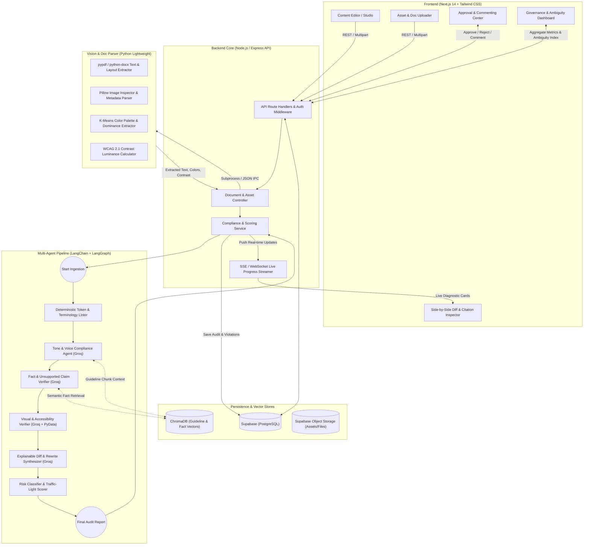
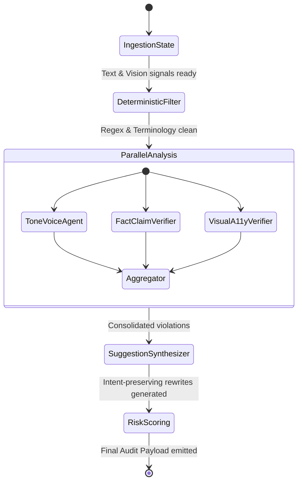
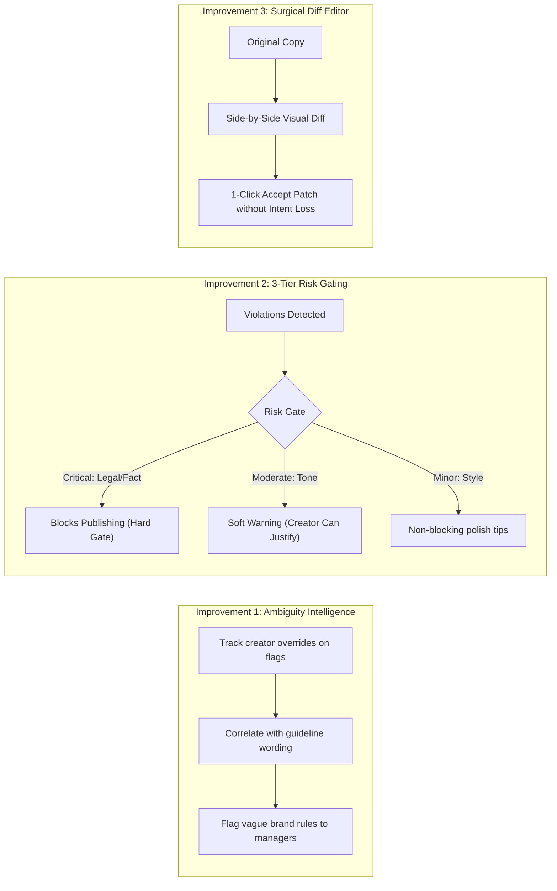
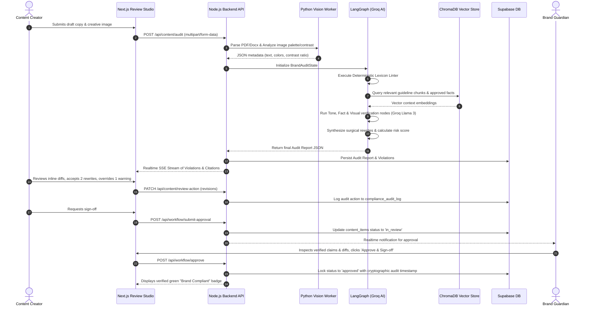

# INKLOOM AI — Master Architecture & Implementation Plan
## Enterprise Brand-Governance & Multi-Modal Content Compliance Platform

---

## 1. Executive Summary & Vision

**Inkloom AI** is an intelligent, multi-modal brand governance and content pre-publication platform. As modern enterprises scale, content is produced across decentralized internal marketing teams, external agencies, and generative AI tools. This decentralization often results in inconsistent tone, outdated factual claims, off-brand visuals, and legal exposure.

Inkloom AI solves this challenge by serving as an **automated, explainable, and human-in-the-loop brand guardian**. Rather than simply rejecting content, Inkloom AI explains *why* an issue was flagged, cites the verified source guideline, and suggests non-destructive revisions that preserve the creator's voice and original intent.

### Alignment with Competition Rounds & Judging Criteria
* **Round 1 (The Plan - 100 pts):** In-depth problem definition, modular architecture, complete entity data schemas, multi-agent LangGraph workflow, Groq AI adapter integration, and ethical responsible AI design.
* **Round 2 (The Build - 100 pts):** End-to-end working MVP with Next.js frontend, Node.js backend, LangGraph multi-agent pipeline, ChromaDB vector retrieval, Supabase storage, Python vision/doc tools, and the **Three Signature Improvements**.
* **Round 3 (The Finish - 100 pts):** High reliability, governance analytics dashboard, recurring error detection, rule ambiguity scoring, complete audit logging, and production readiness.

---

## 2. Technology Stack & Design Principles

```
+-----------------------------------------------------------------------------------+
|                                  INKLOOM AI STACK                                 |
+-----------------------------------------------------------------------------------+
| Frontend UI          | Next.js 14+ (App Router), Tailwind CSS, shadcn/ui, Lucide |
| Backend API Engine   | Node.js (TypeScript), Express / Modular Route Architecture |
| AI Orchestration     | LangChain + LangGraph State Machine Architecture           |
| LLM Inference Engine | Groq AI Adapter (@langchain/groq) - Llama 3.3 70B & 8B    |
| Vector Database      | ChromaDB (Vector embeddings for guidelines & facts)        |
| Relational Database  | Supabase (PostgreSQL with RLS, Storage & Realtime)         |
| Vision & Doc Engine  | Python Lightweight Zero-Dependency Libraries (Pillow,      |
|                      | pypdf, python-docx, pure WCAG luminance color algorithms)  |
+-----------------------------------------------------------------------------------+
```

### Core Architectural Principles
1. **Zero External Software Downloads:** Vision and document processing relies exclusively on pure Python pip libraries (`Pillow`, `pypdf`, `python-docx`) that require no desktop binaries, native system installers, or external OCR software.
2. **Product-Grade Modularity:** Clean separation of concerns between UI components, backend controllers, agent nodes, vector stores, and database models.
3. **Sub-Second Feedback Loop:** Utilizing Groq's high-speed inference engine for streaming token-level linting and multi-agent consensus in under 3 seconds.
4. **Explainability First:** Every flag must be paired with:
   * Rule Citation (document and paragraph ID)
   * Semantic Violation Category (Tone, Fact, Claim, Visual, A11y)
   * Non-destructive Surgical Rewrite Proposal
   * Severity Matrix Tier (Critical / Moderate / Minor)

---

## 3. High-Level System Architecture & End-to-End Workflow



---

## 4. Database Schema Design (Supabase PostgreSQL)

The schema supports multi-tenancy, immutable audit trails, revision tracking, and granular role-based review workflows.

```sql
-- 1. Organizations & Workspaces
CREATE TABLE organizations (
    id UUID PRIMARY KEY DEFAULT gen_random_uuid(),
    name TEXT NOT NULL,
    slug TEXT UNIQUE NOT NULL,
    created_at TIMESTAMPTZ DEFAULT NOW()
);

-- 2. User Profiles & Role-Based Access Control (RBAC)
-- Roles: 'creator', 'reviewer', 'brand_manager', 'admin'
CREATE TABLE users (
    id UUID PRIMARY KEY REFERENCES auth.users(id),
    org_id UUID REFERENCES organizations(id) ON DELETE CASCADE,
    email TEXT NOT NULL,
    full_name TEXT NOT NULL,
    role TEXT NOT NULL CHECK (role IN ('creator', 'reviewer', 'brand_manager', 'admin')),
    avatar_url TEXT,
    created_at TIMESTAMPTZ DEFAULT NOW()
);

-- 3. Brand Knowledge Base: Core Guidelines
CREATE TABLE brand_guidelines (
    id UUID PRIMARY KEY DEFAULT gen_random_uuid(),
    org_id UUID REFERENCES organizations(id) ON DELETE CASCADE,
    title TEXT NOT NULL,
    category TEXT NOT NULL CHECK (category IN ('tone_voice', 'messaging', 'visual', 'accessibility', 'legal')),
    content TEXT NOT NULL,
    version INTEGER DEFAULT 1,
    is_active BOOLEAN DEFAULT TRUE,
    created_by UUID REFERENCES users(id),
    updated_at TIMESTAMPTZ DEFAULT NOW()
);

-- 4. Brand Knowledge Base: Approved Facts & Claim Matrix
CREATE TABLE approved_facts (
    id UUID PRIMARY KEY DEFAULT gen_random_uuid(),
    org_id UUID REFERENCES organizations(id) ON DELETE CASCADE,
    claim_topic TEXT NOT NULL,
    approved_statement TEXT NOT NULL,
    source_citation TEXT NOT NULL, -- e.g., 'Q3 2025 Financial Audit, p. 14'
    verification_date DATE NOT NULL,
    is_active BOOLEAN DEFAULT TRUE,
    created_at TIMESTAMPTZ DEFAULT NOW()
);

-- 5. Brand Knowledge Base: Terminology Dictionary & Banned Lexicon
CREATE TABLE terminology_rules (
    id UUID PRIMARY KEY DEFAULT gen_random_uuid(),
    org_id UUID REFERENCES organizations(id) ON DELETE CASCADE,
    term_pattern TEXT NOT NULL, -- The forbidden term (e.g., 'cheap', 'foolproof')
    preferred_term TEXT NOT NULL, -- Approved replacement (e.g., 'cost-effective', 'intuitive')
    rule_type TEXT NOT NULL CHECK (rule_type IN ('banned', 'trademark_capitalization', 'preferred_synonym')),
    explanation TEXT NOT NULL,
    created_at TIMESTAMPTZ DEFAULT NOW()
);

-- 6. Brand Knowledge Base: Visual Assets & Color Palette
CREATE TABLE visual_brand_kits (
    id UUID PRIMARY KEY DEFAULT gen_random_uuid(),
    org_id UUID REFERENCES organizations(id) ON DELETE CASCADE,
    kit_name TEXT NOT NULL,
    primary_colors JSONB NOT NULL, -- ['#0F172A', '#3B82F6']
    secondary_colors JSONB NOT NULL, -- ['#64748B', '#F1F5F9']
    min_contrast_ratio NUMERIC DEFAULT 4.5, -- WCAG AA standard
    approved_fonts JSONB NOT NULL, -- ['Inter', 'Geist']
    logo_assets JSONB NOT NULL, -- Storage bucket URLs with clearspace rules
    created_at TIMESTAMPTZ DEFAULT NOW()
);

-- 7. Content Items Under Review
-- Formats: 'text_copy', 'document_pdf', 'document_docx', 'image_creative'
-- Status: 'draft', 'in_review', 'changes_requested', 'approved', 'published'
CREATE TABLE content_items (
    id UUID PRIMARY KEY DEFAULT gen_random_uuid(),
    org_id UUID REFERENCES organizations(id) ON DELETE CASCADE,
    author_id UUID REFERENCES users(id),
    title TEXT NOT NULL,
    content_format TEXT NOT NULL CHECK (content_format IN ('text_copy', 'document_pdf', 'document_docx', 'image_creative')),
    raw_text TEXT,
    asset_file_url TEXT,
    status TEXT NOT NULL DEFAULT 'draft' CHECK (status IN ('draft', 'in_review', 'changes_requested', 'approved', 'published')),
    created_at TIMESTAMPTZ DEFAULT NOW(),
    updated_at TIMESTAMPTZ DEFAULT NOW()
);

-- 8. Content Audit Reports
CREATE TABLE audit_reports (
    id UUID PRIMARY KEY DEFAULT gen_random_uuid(),
    content_id UUID REFERENCES content_items(id) ON DELETE CASCADE,
    overall_compliance_score INTEGER NOT NULL CHECK (overall_compliance_score BETWEEN 0 AND 100),
    tone_score INTEGER,
    factual_score INTEGER,
    claim_score INTEGER,
    visual_score INTEGER,
    accessibility_score INTEGER,
    risk_level TEXT NOT NULL CHECK (risk_level IN ('pass', 'warning', 'critical_blocker')),
    execution_time_ms INTEGER NOT NULL,
    created_at TIMESTAMPTZ DEFAULT NOW()
);

-- 9. Audit Violations & Explainable Findings
CREATE TABLE audit_violations (
    id UUID PRIMARY KEY DEFAULT gen_random_uuid(),
    audit_report_id UUID REFERENCES audit_reports(id) ON DELETE CASCADE,
    category TEXT NOT NULL CHECK (category IN ('tone', 'terminology', 'factual_inaccuracy', 'unsupported_claim', 'visual_inconsistency', 'accessibility')),
    severity TEXT NOT NULL CHECK (severity IN ('critical', 'moderate', 'minor')),
    violating_excerpt TEXT NOT NULL,
    line_start INTEGER,
    line_end INTEGER,
    explanation TEXT NOT NULL,
    guideline_id UUID REFERENCES brand_guidelines(id),
    suggested_rewrite TEXT NOT NULL,
    status TEXT NOT NULL DEFAULT 'open' CHECK (status IN ('open', 'accepted', 'rejected', 'modified')),
    created_at TIMESTAMPTZ DEFAULT NOW()
);

-- 10. Review Collaboration, Comments & Approvals
CREATE TABLE review_threads (
    id UUID PRIMARY KEY DEFAULT gen_random_uuid(),
    content_id UUID REFERENCES content_items(id) ON DELETE CASCADE,
    violation_id UUID REFERENCES audit_violations(id) ON DELETE SET NULL,
    author_id UUID REFERENCES users(id),
    comment_text TEXT NOT NULL,
    created_at TIMESTAMPTZ DEFAULT NOW()
);

-- 11. Immutable Audit & Sign-off Trail
CREATE TABLE compliance_audit_log (
    id UUID PRIMARY KEY DEFAULT gen_random_uuid(),
    content_id UUID REFERENCES content_items(id) ON DELETE CASCADE,
    actor_id UUID REFERENCES users(id),
    action TEXT NOT NULL CHECK (action IN ('submitted_review', 'applied_suggestion', 'approved_content', 'overridden_warning', 'published')),
    metadata JSONB,
    timestamp TIMESTAMPTZ DEFAULT NOW()
);

-- 12. Governance Analytics & Guideline Ambiguity Tracking
CREATE TABLE guideline_ambiguity_metrics (
    id UUID PRIMARY KEY DEFAULT gen_random_uuid(),
    org_id UUID REFERENCES organizations(id) ON DELETE CASCADE,
    guideline_id UUID REFERENCES brand_guidelines(id) ON DELETE CASCADE,
    times_flagged INTEGER DEFAULT 0,
    times_overridden INTEGER DEFAULT 0,
    times_accepted INTEGER DEFAULT 0,
    ambiguity_friction_index NUMERIC DEFAULT 0.0,
    updated_at TIMESTAMPTZ DEFAULT NOW()
);
```

---

## 5. ChromaDB Vector Store Strategy

ChromaDB provides local, lightweight, and performant vector retrieval for brand rules and verified facts without requiring external cloud accounts.

### Collections Structure
1. `inkloom_guidelines`:
   * **Document:** Chunks of the official Brand Guidelines (Tone, Messaging, Formatting, Editorial Rules).
   * **Metadata:** `{ "org_id": "...", "category": "tone_voice", "section": "Section 4.2 - Empathy vs Authority", "rule_id": "..." }`
2. `inkloom_facts`:
   * **Document:** Atomic verified facts, company statistics, and product capability claims.
   * **Metadata:** `{ "org_id": "...", "topic": "latency", "verified_date": "2025-10-01", "source": "Engineering Benchmark v3" }`

### Retrieval Strategy in LangGraph
* When evaluating content, the `FactClaimVerifierNode` extracts candidate factual and marketing claims using Groq.
* For each claim, a similarity query is dispatched to ChromaDB (`n_results=3, distance_metric='cosine'`).
* If `cosine_distance > threshold`, the claim is classified as **"Unsupported Promotional Claim"** and sent to the synthesis node for citation and softening.

---

## 6. Multi-Agent Pipeline via LangGraph & Groq AI

The multi-agent core is built with `@langchain/langgraph` running in Node.js, powered by `@langchain/groq`.



### 6.1 State Schema (`BrandAuditState`)
```typescript
interface ViolationItem {
  id: string;
  category: 'tone' | 'terminology' | 'factual_inaccuracy' | 'unsupported_claim' | 'visual_inconsistency' | 'accessibility';
  severity: 'critical' | 'moderate' | 'minor';
  violatingExcerpt: string;
  explanation: string;
  sourceCitation: string;
  suggestedRewrite: string;
  characterRange?: [number, number];
}

interface BrandAuditState {
  orgId: string;
  contentId: string;
  rawText: string;
  mediaMetadata?: {
    dominantColors: string[];
    contrastRatios: number[];
    dimensions: { width: number; height: number };
  };
  terminologyViolations: ViolationItem[];
  toneViolations: ViolationItem[];
  factViolations: ViolationItem[];
  visualViolations: ViolationItem[];
  finalViolations: ViolationItem[];
  complianceScore: number;
  riskTier: 'pass' | 'warning' | 'critical_blocker';
}
```

### 6.2 Agent Nodes & Groq LLM Roles

#### Node 1: Deterministic Token Linter (`DeterministicFilter`)
* **Logic:** Pure TypeScript regex engine executing in sub-50ms.
* **Checks:** Exact matches against `terminology_rules` (banned words, non-standard spelling, trademark casing, missing registration symbols `®`).
* **Output:** Instant violations without incurring LLM cost.

#### Node 2: Tone & Voice Compliance Agent (`ToneVoiceAgent`)
* **Model:** Groq `llama-3.3-70b-versatile` (Temperature: 0.1).
* **Task:** Ingests brand tone rules retrieved from ChromaDB. Analyzes the content's sentiment, formality, empathy, and vocabulary.
* **Output:** Identifies paragraphs where tone drifts into overly aggressive, passive, colloquial, or off-brand phrasing.

#### Node 3: Fact & Unsupported Claim Verifier (`FactClaimVerifier`)
* **Model:** Groq `llama-3.3-70b-versatile` (Temperature: 0.0).
* **Task:**
  1. Identifies any superlative ("fastest", "world's first", "#1"), statistical ("99.99%"), or capability claims.
  2. Queries ChromaDB `inkloom_facts` collection.
  3. Validates whether the claim is strictly supported.
  4. Flags unsupported promotional statements with warning severity.

#### Node 4: Visual & Accessibility Verifier (`VisualA11yVerifier`)
* **Input:** Processed data from Python vision worker.
* **Task:**
  * Checks if dominant extracted hex colors match the `visual_brand_kits` table.
  * Verifies WCAG contrast ratios (minimum 4.5:1 for standard text, 3:1 for large display text).
  * Evaluates image alt-text descriptions against clarity guidelines.

#### Node 5: Non-Destructive Suggestion Synthesizer (`SuggestionSynthesizer`)
* **Model:** Groq `llama-3.3-70b-versatile` (Temperature: 0.2).
* **Task:** For each violation, synthesizes a replacement that **preserves the creator's voice and semantic intent**.
* **Strict Prompt Instruction:** *"Do not sterilize the content or turn human copy into generic robotic text. Make surgical, minimal edits to resolve the brand violation while keeping the author's original sentence cadence and perspective."*

#### Node 6: Risk Classifier & Scorer (`RiskScoring`)
* **Scoring Formula:**
  $$\text{Score} = 100 - \left( \sum \text{Critical} \times 20 + \sum \text{Moderate} \times 8 + \sum \text{Minor} \times 3 \right)$$
* Clamped between $0$ and $100$.
* If any **Critical** legal or factual violation exists, the content status is locked to `critical_blocker`.

---

## 7. Python Lightweight Document & Vision Tooling (Zero External Software)

To strictly follow the requirement of **no external software downloads, no desktop packages, and no OCR native installers**, we leverage pure Python standard packages and pre-compiled wheels:

### Tools Architecture: `services/vision-worker/`

```
services/vision-worker/
├── doc_extractor.py       # pypdf + python-docx text & metadata extraction
├── palette_analyzer.py    # Pure Pillow (PIL) + K-Means color clustering
├── wcag_contrast.py       # Mathematical relative luminance & contrast checker
└── worker_cli.py          # Fast CLI / JSON IPC bridge for Node.js
```

### 1. Document Parsing (`doc_extractor.py`)
* Uses `pypdf` for PDF text extraction without system poppler utilities.
* Uses `python-docx` for `.docx` word processing document extraction.
* Emits structured JSON: `{ "text": "...", "pageCount": 4, "metadata": { ... } }`.

### 2. Pure Python Palette Extractor (`palette_analyzer.py`)
* Uses `Pillow` (PIL) to open and resize uploaded graphics/banners to a $150 \times 150$ thumbnail.
* Uses a pure Python K-Means clustering algorithm on RGB vectors to extract the top 5 dominant hex colors without needing heavy C-extensions.

### 3. Pure Mathematical WCAG 2.1 Contrast Checker (`wcag_contrast.py`)
Computes luminance using standard W3C relative luminance equations:
$$L = 0.2126 \times R_{\text{lin}} + 0.7152 \times G_{\text{lin}} + 0.0722 \times B_{\text{lin}}$$
where linear RGB is computed via gamma expansion:
$$C_{\text{lin}} = \begin{cases} \frac{C_{\text{srgb}}}{12.92} & \text{if } C_{\text{srgb}} \le 0.04045 \\ \left(\frac{C_{\text{srgb}} + 0.055}{1.055}\right)^{2.4} & \text{otherwise} \end{cases}$$
The contrast ratio between two colors is:
$$\text{Ratio} = \frac{L_1 + 0.05}{L_2 + 0.05} \quad (\text{where } L_1 > L_2)$$
* Validates whether text overlay against banner backgrounds meets **4.5:1 (AA standard)** or **7:1 (AAA standard)**.

### 4. Node.js Integration
The Node.js backend invokes the Python worker via streaming JSON standard input/output (`child_process.spawn('python', ['worker_cli.py', ...])`), ensuring zero-latency memory sharing and modular decoupling.

---

## 8. The Three Signature Improvements (Hackathon Differentiators)

To maximize points under the specific judging criteria for **Rounds 2 and 3 ("The three improvements you named and delivered")**, Inkloom AI incorporates three novel capabilities:



### Improvement 1: Guideline Ambiguity & Friction Scoring Engine
* **The Insight:** Often content creators violate brand rules not out of negligence, but because the brand guideline itself is contradictory, subjective, or outdated.
* **Mechanism:** When multiple reviewers or creators reject or override an AI suggestion on a specific rule, Inkloom AI increases the rule's **Ambiguity Friction Index**.
* **Value to Leadership:** The platform alerts Brand Managers: *"Section 3.1 ('Be approachable yet authoritative') has an 82% override rate. The guideline is ambiguous and needs clarification."*

### Improvement 2: 3-Tier Risk-Gated Approval Engine
* **The Insight:** Rigid rules that block publication for minor stylistic preferences frustrate marketing velocity.
* **Mechanism:**
  * **Tier 1 (Critical Blocker):** Factual untruths, unsupported quantitative claims, banned terms, trademark infringements. *Requires Brand Manager sign-off.*
  * **Tier 2 (Moderate Warning):** Tone deviations, reading grade level mismatch. *Creator can override with a recorded justification.*
  * **Tier 3 (Minor Polish):** Synonyms, formatting improvements. *Purely advisory.*

### Improvement 3: Non-Destructive Intent-Preserving Surgical Diff Editor
* **The Insight:** Creators hate AI that rewrites their whole draft into bland corporate speak.
* **Mechanism:** A visual Git-like unified diff view built in the Next.js UI. It isolates the exact violating phrase and displays the proposed rewrite side-by-side with rule citations.
* **Action:** Creators can click **"Accept Patch"** (instant replacement) or **"Counter-Propose"**, updating the document while maintaining original styling and cadence.

---

## 9. Comprehensive Feature Breakdown & Wiring



### Feature 1: Brand Knowledge Hub
* **Admin / Manager Portal:**
  * Bulk upload brand guidelines (PDF/Markdown) $\to$ automatic semantic chunking $\to$ embedded into ChromaDB.
  * Fact Matrix Table: Manage approved statistics, source links, and deprecation dates.
  * Terminology Dictionary: Add banned phrases, trademark symbols, and mandatory disclaimers.
  * Brand Visual Kit: Configure primary/secondary hex palettes, minimum contrast ratios, and logo usage rules.

### Feature 2: Multi-Modal Review Studio
* **Interactive Writing & Audit Environment:**
  * Markdown / Rich text editor with live compliance status indicator.
  * Multi-format file uploader (PDF, DOCX, PNG, JPG).
  * Real-time streaming diagnostic cards showing:
    * Violation snippet highlighted in document
    * Categorized severity badge (Red/Amber/Blue)
    * Exact citation to Brand Guideline with link
    * One-click "Apply Suggested Rewrite" button

### Feature 3: Collaborative Approval & Review Workflow
* **Enterprise Role-Based State Machine:**
  * Authors submit content for review.
  * Assign reviewers based on content type (e.g., Legal reviewer for claims, Brand manager for visual/tone).
  * In-line threaded discussion directly on violation cards.
  * Immutable event log capturing who approved what, when, and which overrides were granted.

### Feature 4: Governance Analytics & Ambiguity Intelligence
* **Brand Leadership Insights:**
  * **Violations Over Time:** Trends showing which departments produce the most brand drift.
  * **Frequent Offender Lexicon:** Top 10 banned terms still being used across the company.
  * **Ambiguity Friction Heatmap:** Pinpoints brand guidelines that generate the highest friction and creator disagreements.

### Feature 5: Privacy, Enterprise Security & AI Transparency
* **Responsible AI & Disclosure:**
  * Client-side sanitization of emails, telephone numbers, and API tokens before forwarding text to Groq inference.
  * Automated **"AI Governance Transparency Card"** attached to every publication, disclosing model used, verification timestamp, and compliance score.

---

## 10. Project Directory Layout (Modular Enterprise Monorepo)

```
inkloom/
├── apps/
│   ├── web/                                 # Next.js 14+ Frontend Application
│   │   ├── app/
│   │   │   ├── layout.tsx                   # Root layout with theme & auth providers
│   │   │   ├── page.tsx                     # Landing / Overview page
│   │   │   ├── dashboard/                   # Main dashboard
│   │   │   ├── studio/                      # Content Review & Editor Studio
│   │   │   │   ├── page.tsx
│   │   │   │   └── [id]/page.tsx            # Specific content review workspace
│   │   │   ├── knowledge-hub/               # Brand guidelines & facts management
│   │   │   │   ├── guidelines/page.tsx
│   │   │   │   ├── facts/page.tsx
│   │   │   │   └── terminology/page.tsx
│   │   │   ├── workflows/                   # Approval queues & review requests
│   │   │   │   └── page.tsx
│   │   │   └── analytics/                   # Governance & Ambiguity dashboards
│   │   │       └── page.tsx
│   │   ├── components/
│   │   │   ├── editor/                      # Rich text editor with inline highlights
│   │   │   ├── review/                      # Diagnostic cards, diff inspector, citations
│   │   │   ├── visual/                      # Image contrast & palette viewers
│   │   │   ├── workflow/                    # Approval state machine & comment threads
│   │   │   └── ui/                          # Radix / shadcn reusable UI components
│   │   ├── hooks/                           # Custom React query & SSE hooks
│   │   ├── lib/                             # Supabase browser client & utility helpers
│   │   └── tailwind.config.ts
│   │
│   └── server/                              # Node.js Express Backend API
│       ├── src/
│       │   ├── index.ts                     # Server bootstrap & middleware
│       │   ├── config/                      # Environment variables, Groq & Supabase keys
│       │   ├── controllers/
│       │   │   ├── audit.controller.ts      # Triggers LangGraph & streams findings
│       │   │   ├── content.controller.ts    # Drafts, file uploads, revisions
│       │   │   ├── knowledge.controller.ts  # Guideline ingest & Chroma indexing
│       │   │   ├── workflow.controller.ts   # Approvals, comments, status transitions
│       │   │   └── analytics.controller.ts  # Aggregated compliance & ambiguity metrics
│       │   ├── routes/                      # Modular REST endpoint routing
│       │   ├── services/
│       │   │   ├── chroma.service.ts        # ChromaDB embeddings & query methods
│       │   │   ├── python-bridge.service.ts # Subprocess IPC with Python worker
│       │   │   └── supabase.service.ts      # Database queries & RLS enforcement
│       │   └── middlewares/                 # Auth, RBAC validation, error handling
│       └── package.json
│
├── packages/
│   ├── agents/                              # LangChain & LangGraph Workflows
│   │   ├── src/
│   │   │   ├── graph.ts                     # Main LangGraph StateGraph assembly
│   │   │   ├── state.ts                     # BrandAuditState interface & reducers
│   │   │   ├── groq-client.ts               # Configured Groq AI adapters
│   │   │   └── nodes/
│   │   │       ├── deterministic-linter.ts  # Regex lexicon & trademark checks
│   │   │       ├── tone-agent.ts            # Tone of voice evaluation
│   │   │       ├── fact-verifier.ts         # Claim extraction & ChromaDB verification
│   │   │       ├── visual-agent.ts          # Palette & contrast compliance
│   │   │       ├── synthesizer.ts           # Surgical diff & citation generation
│   │   │       └── risk-scorer.ts           # Severity scoring & traffic-light logic
│   │   └── package.json
│   │
│   └── types/                               # Shared TypeScript Interfaces
│       ├── index.ts                         # Models, API contracts, Enums
│       └── package.json
│
├── services/
│   └── vision-worker/                       # Python Lightweight Worker
│       ├── doc_extractor.py                 # Pure pypdf & python-docx extractor
│       ├── palette_analyzer.py              # Pillow K-Means dominant color extraction
│       ├── wcag_contrast.py                 # Pure mathematical W3C contrast checker
│       ├── worker_cli.py                    # JSON CLI wrapper for Node.js IPC
│       └── requirements.txt                 # Pillow, pypdf, python-docx
│
├── plan.md                                  # This master architecture plan
├── package.json                             # Monorepo workspaces configuration
└── tsconfig.json                            # Base TypeScript configuration
```

---

## 11. REST API Contract & Endpoint Specification

### Ingestion & Knowledge Base (`/api/knowledge`)
* `POST /api/knowledge/guidelines` — Upload and ingest brand guideline document (splits into chunks, generates embeddings in ChromaDB, records metadata in Supabase).
* `POST /api/knowledge/facts` — Register verified claims, product statistics, and source citations.
* `POST /api/knowledge/terminology` — Define banned words and preferred trademark synonyms.
* `POST /api/knowledge/brand-kit` — Save hex colors, font rules, and contrast thresholds.

### Audit & Review Engine (`/api/audit`)
* `POST /api/audit/analyze` — Initiates multi-agent LangGraph execution on text or uploaded file.
* `GET /api/audit/:id/stream` — Server-Sent Events (SSE) endpoint delivering real-time agent progression and generated violation cards.
* `GET /api/audit/:id` — Retrieves comprehensive audit report with overall compliance score, risk tier, and citation cards.

### Content & Revisions (`/api/content`)
* `POST /api/content` — Create or save draft content.
* `PATCH /api/content/:id/apply-patch` — Applies an AI suggested rewrite surgically to the document.
* `POST /api/content/:id/override` — Creator overrides a non-critical warning with an explicit reason.

### Collaborative Workflows (`/api/workflow`)
* `POST /api/workflow/:contentId/submit` — Submits draft for formal multi-stakeholder review.
* `POST /api/workflow/:contentId/action` — Reviewer approves, rejects, or requests changes.
* `POST /api/workflow/:contentId/comments` — Adds threaded in-line feedback.

### Analytics & Governance (`/api/analytics`)
* `GET /api/analytics/overview` — High-level compliance rate and volume across departments.
* `GET /api/analytics/ambiguity-index` — Top brand guidelines with highest friction/override rates.
* `GET /api/analytics/frequent-violations` — Distribution of violations by category (Tone vs Claim vs Visual).

---

## 12. Phased Implementation Roadmap & Execution Checklist

### Phase 1: Foundation & Infrastructure (Round 1 Focus)
- [x] Problem statement deep analysis and architectural design.
- [ ] Initialize monorepo workspace (`apps/web`, `apps/server`, `packages/agents`, `services/vision-worker`).
- [ ] Set up Supabase PostgreSQL tables and migrations.
- [ ] Configure local ChromaDB client for guideline and fact collections.
- [ ] Establish Python vision worker with Pillow, pypdf, and WCAG contrast logic.
- [ ] Configure Groq AI client with Llama-3.3-70b-versatile.

### Phase 2: Core Build & Multi-Agent Engine (Round 2 Focus)
- [ ] Implement `BrandAuditState` and LangGraph state machine with Groq.
- [ ] Wire Node 1 (Deterministic Linter) for banned terms and trademark casing.
- [ ] Wire Node 2 (Tone & Voice Agent) grounded on guideline vectors.
- [ ] Wire Node 3 (Fact & Claim Verifier) checking ChromaDB facts.
- [ ] Wire Node 4 (Visual & Accessibility Agent) processing Python worker metrics.
- [ ] Wire Node 5 (Synthesizer) creating side-by-side surgical rewrites.
- [ ] Wire Node 6 (Risk Scorer) computing compliance index (0-100) and traffic light risk.
- [ ] Build Next.js Review Studio with real-time SSE streaming diagnostic cards.
- [ ] Implement the **Three Signature Improvements**:
  1. Guideline Ambiguity & Friction Scoring.
  2. 3-Tier Risk Gating (Hard Block vs Soft Warning).
  3. Interactive Side-by-Side Unified Diff View with 1-click patch application.

### Phase 3: Workflow, Analytics & Polish (Round 3 Focus)
- [ ] Implement Role-Based Access Control (Creator, Reviewer, Brand Manager).
- [ ] Build approval state machine, revision diff tracking, and audit log.
- [ ] Create Governance Analytics Dashboard (Violation heatmaps & Ambiguity index).
- [ ] Build responsible AI disclosure badge and metadata manifest generator.
- [ ] End-to-end integration testing across sample text, PDF documents, and marketing images.
- [ ] Prepare demonstration script, video walkthrough, and submission documentation.
